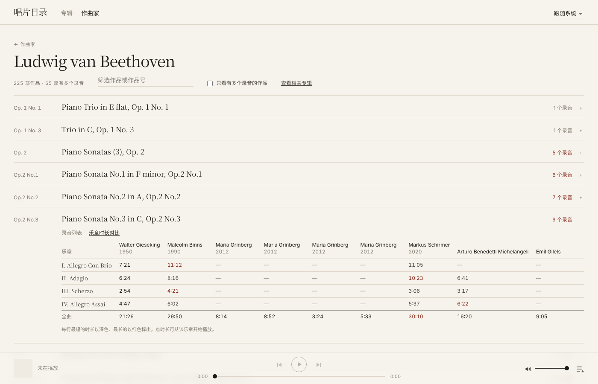

# 唱片目录 · pan-classical-player

一个为**古典音乐**设计的播放器，曲库存放在**百度网盘**里。适合把 CD 抓轨（FLAC / ALAC / APE / CUE 整轨等）存在网盘、又不想下载到本地的人。

- **专辑墙**：封面网格，按作曲家、演奏者、厂牌、年代筛选，全文搜索（中英文、忽略重音）
- **按作品和乐章组织**：自动识别作曲家（约 150 位常见作曲家的中英德法日俄写法）、作品、作品号与乐章，支持 CUE 整轨
- **作曲家页面**：同一作品在曲库里的所有录音一览，并可对比各版本每个乐章的时长
- **无缝播放**：attacca 衔接的乐章、连续的现场录音，乐章之间没有停顿或爆音（服务器端采样级拼接）
- **跨境友好**：边下边播、多连接分段下载、预取下一首、本地 LRU 缓存；在海外访问国内网盘也能流畅播放
- **专辑小册子**：浏览专辑文件夹里的扫描图片和 PDF
- **Mac 应用**：可打包成独立的「唱片目录.app」，接入控制中心「正在播放」与媒体键；也可以直接在浏览器里用
- 只使用[百度网盘开放平台](https://pan.baidu.com/union)的**官方接口**（设备码授权），不模拟登录、不抓取 Cookie



> 本项目与百度公司无关。请只用它播放你有权使用的音乐。

## 准备

1. **百度网盘开放平台应用**（每位用户用自己的）：登录 [pan.baidu.com/union/console](https://pan.baidu.com/union/console)，创建应用，「应用用途」选**个人使用**、类型选**软件**。创建后在应用详情页拿到 **AppKey** 和 **SecretKey**。
2. **软件依赖**（macOS，需要 [Homebrew](https://brew.sh)）：
   ```bash
   brew install python@3.11 node ffmpeg
   ```
   Linux 也可以运行（浏览器模式），装好 Python 3.11+、Node 18+、ffmpeg 即可。

## 安装与使用

```bash
git clone https://github.com/<你的用户名>/pan-classical-player.git
cd pan-classical-player
make setup                       # 安装依赖，生成 .env
open -e .env                     # 填写 BAIDU_APP_KEY、BAIDU_SECRET_KEY、MUSIC_ROOT（曲库在网盘中的路径，如 /音乐）
backend/.venv/bin/pan auth       # 设备码授权：按提示在浏览器里输入用户码
backend/.venv/bin/pan scan       # 扫描曲库（首次较慢，可随时 Ctrl+C，下次接着来）
make dev                         # 打开 http://localhost:5173
```

想要 Mac 应用：`make install-app`，之后在「应用程序」里打开「唱片目录」（详见下文）。

曲库里的 `.zip` 等压缩包会被跳过，清单见 `backend/.venv/bin/pan zips`；在网盘里在线解压后重新扫描即可。

## 开发

```bash
make test     # 后端测试（需要 ffmpeg）
make dev      # 前端热更新 + 后端自动重载
```

技术栈：Python 3.11 + FastAPI + SQLite + httpx + mutagen；React + Vite + TypeScript + Tailwind v4；Mac 应用用 pywebview + PyInstaller。

```
backend/app/
  baidu/      开放平台客户端：授权与刷新、文件列表、dlink、Range 读取
  indexer/    索引器：标签/CUE 解析、作曲家与作品识别、专辑组装、封面
  stream/     流媒体：分段下载与缓存、Range 代理、无缝拼接（虚拟 WAV）
  library.py  专辑列表、搜索、作曲家与版本归并
  desktop.py  Mac 应用入口
frontend/src/ 页面、播放引擎（player/engine.ts）、组件
packaging/    PyInstaller 配置、图标、安装脚本
data/         授权 token、SQLite、封面、缓存（不入库）
```

## 命令行

```bash
PAN=backend/.venv/bin/pan
$PAN config            # 查看当前配置（不显示密钥）
$PAN auth              # 设备码授权：终端显示用户码，浏览器中确认
$PAN whoami [--refresh]  # 账号信息与 token 有效期（--refresh 强制刷新）
$PAN ls [路径] [-n 50]   # 列出曲库前 N 个文件
$PAN speedtest [--fsid N] [--keep]  # 列出前 50 个文件，并完整下载一首 FLAC 测速
$PAN probe             # 打印各接口原始返回结构（dlink/token 已遮蔽），并测试 Range 请求
$PAN scan              # 增量扫描：只处理新增/变化的文件
$PAN rescan            # 全量重读所有元数据与封面
$PAN stats             # 索引统计
$PAN show <id|关键字>   # 查看专辑：作品、乐章、格式
$PAN zips              # 曲库中的压缩包清单（扫描时跳过）
make test              # 离线单元测试（模拟网盘接口）
```

## 百度网盘接口（backend/app/baidu）

| 用途 | 接口 |
|---|---|
| 设备码 | `GET openapi.baidu.com/oauth/2.0/device/code?response_type=device_code&client_id&scope=basic,netdisk` |
| 轮询 / 刷新 | `GET openapi.baidu.com/oauth/2.0/token`，`grant_type=device_token` 或 `refresh_token` |
| 用户信息 | `GET pan.baidu.com/rest/2.0/xpan/nas?method=uinfo` |
| 递归列表 | `GET .../xpan/multimedia?method=listall&path&recursion=1&start&limit=1000`，按 `has_more` / `cursor` 翻页 |
| 文件信息 | `GET .../xpan/multimedia?method=filemetas&fsids=[...]&dlink=1`，每批最多 100 个 |
| 下载 | `GET {dlink}&access_token=…`，`User-Agent: pan.baidu.com`，跟随 302 |

- token 保存在 `data/token.json`（权限 600）。access_token 距过期不足 24 小时时自动刷新；接口返回 token 失效（errno -6 / 110 / 111）时刷新并重试一次。
- 频率限制（errno 31034）、5xx 和网络错误按指数退避重试，最多 5 次。
- 所有请求都有超时：连接 15s、读取 60s。
- dlink 只在需要时现取，不落盘。

## 索引器（backend/app/indexer）

- **遍历**：本应用无权使用 `listall`（errno 20020），用 `list` 并发逐层遍历（`LIST_CONCURRENCY`）。有目录列取失败时，本次不删除任何记录。
- **增量**：`files` 表按 `fs_id` + `server_mtime` + 路径判断变化；只重建受影响的专辑文件夹，未变化文件的解析结果直接复用。扫描中断后，下次会继续重建未写完的专辑。
- **只读头部**：先 Range 取 256KB；FLAC 逐块读取元数据块头，只取 STREAMINFO / VORBIS_COMMENT / CUESHEET，跳过内嵌图片；ALAC/MP3/APE/WavPack 交给 mutagen，缺的片段按需补取（MP4 的 moov 在文件末尾也能读到）。
- **专辑**：一个含音频的文件夹即一张专辑；`CD1`、`Disc 2`、`第2张` 等子文件夹合并为分碟。
- **CUE**：自动识别 GBK / Big5 / Shift-JIS / UTF-8 / Latin-1 编码；按 CUE 把整轨拆成虚拟曲目（`start_offset` / `end_offset`，秒），FILE 名不匹配时按同名或唯一音频文件对应；也支持 FLAC 内嵌的 CUESHEET 标签。
- **作品与乐章**：优先 WORK / MOVEMENTNAME / MOVEMENT 标签；否则从标题拆分（`作品: I. 乐章`、`作品 - 2. 乐章`、`Var. 1` 等），并提取作品号（Op.、BWV、K.、D.、Hob.…）。有作曲家但拆不出乐章的单曲视为单乐章作品。
- **作曲家**：`indexer/composers.py` 收录约 150 位作曲家的各种写法（英/德/法/中/日/俄），把 `Mozart, Wolfgang Amadeus`、`W. A. Mozart`、`莫扎特` 统一为同一规范名。没有 COMPOSER 标签时，依次从标题前缀（`SCHUMANN Piano…`、`Grieg: …`）、WORK、专辑名、艺术家、上级文件夹名中识别（只认唯一一位）。
- **回退**：缺标签时从文件名取曲号与标题；只有乐章名（`IV. Adagio`）的曲目，若整张专辑名像作品名则用专辑名作作品。找不到作曲家、标题来自文件名、或作品名是推测的，都标记"元数据不全"。
- **封面**：cover / folder / front.jpg 优先；其次第一首的内嵌封面；再次文件夹（含 Scans/ 等子文件夹）里文件名带 cover/front 的图片，最后取排除 back/booklet/cd 等之后的第一张图。原图存 `data/covers/orig/`，600px 缩略图存 `data/covers/{album_id}.jpg`，经 `/covers/` 提供。
- **规则升级**：组装规则改动时（`ASSEMBLY_VERSION`），下次 `pan scan` 会用缓存的元数据重建全部专辑，无需重新下载；解析失败的文件在解析器升级后自动重试。
- **格式识别**：按文件头判断真实格式（例如 `.wav` 实为 APE）；GBK 编码的 APEv2 标签逐项解码。
- **跳过**：`.zip/.rar/.7z` 写入 `data/zip_list.txt`；DSD/ISO/TAK 等暂不支持的格式只计数。

## 流媒体代理（backend/app/stream）

- `GET/HEAD /stream/{track_id}`：完整支持 Range（`206`、`Content-Range`、`Accept-Ranges`、后缀区间、`416`）。CUE 分轨返回整轨文件，由前端按 `start_offset` / `end_offset` 定位。
- **边下边播**：第一次请求某个文件时，后台把整个文件下载到 `data/cache/`，分 8MB 分段、`PLAY_CONNECTIONS` 条连接并发下载；浏览器请求的字节一到就转发，不等整首下完。
- **拖动**：拖到尚未下载的位置时，在该位置把分段切开并立即单开一条连接，等待时间约等于一次首字节延迟；之后从该位置连续往后下载。空闲连接会分担剩余最多的分段。
- **预取**：`POST /api/prefetch/{track_id}`，用 `PREFETCH_CONNECTIONS` 条连接把下一首下载到缓存；同时最多 4 个下载任务，超出时先取消最早的预取。
- **缓存**：文件名 `{fsid}_{server_mtime}{扩展名}`，网盘文件变化后自动失效；总大小超过 `CACHE_MAX_GB` 时按最近使用时间淘汰（正在播放或下载的不删）。`GET /api/cache` 查看状态。
- **容错**：dlink 在内存中缓存 1 小时（有效期 8 小时），从不落盘；返回 403/404/410 时重新获取一次；连接中途断开从断点续传，单个文件连续失败 5 次才放弃。

## 前端（frontend/src）

- **页面**（哈希路由）：`#/` 专辑墙（作曲家 / 演奏者 / 厂牌 / 年代筛选，五种排序，全文搜索，筛选条件保存在地址里）；`#/album/{id}` 专辑详情（按碟、作品分组，乐章用罗马数字，与专辑主格式不同的曲目单独标出格式）；`#/composers` 作曲家索引（按姓氏）；`#/composer/{名字}` 该作曲家的全部作品，每部作品列出所有录音，可切换"乐章时长对比"表。
- **播放引擎**（`player/engine.ts`）：单个 `<audio>`，队列与当前位置保存在 localStorage；CUE 分轨按 `start_offset`/`end_offset` 定位，同一整轨内的下一乐章只切换显示、不打断播放；播放时预取下一首；ALAC（浏览器不支持时）、APE、WavPack 自动改用 `/stream/{id}/flac?t=秒` 实时转码，拖动进度条时带新的起点重开转码流。
- **Media Session**：锁屏 / 耳机 / 键盘媒体键的播放、暂停、上一首、下一首、快进快退、拖动；显示封面与曲目信息。
- **键盘**：空格 播放/暂停，← → 快退/快进 10 秒，Shift+← → 上一首/下一首。
- **外观**：深浅色跟随系统，可在右上角固定；配色与字体变量在 `index.css`。

后端为前端新增：`/api/albums`（含作曲家、演奏者、主格式等聚合字段，带缓存）、`/api/search?q=`（忽略大小写与重音，作曲家中文名也能搜到）、`/api/composers`、`/api/composer?name=`（按作品号或标题归并同一作品的不同录音）、`/stream/{id}/flac`（ffmpeg 转码）、`/covers/orig/…`（原尺寸封面）。

## 无缝播放

- **思路**：不在浏览器里拼接两个 `<audio>`（做不到采样级精确），而是让后端把需要无缝衔接的几首拼成**一条**流，浏览器只播放一个源。
- **`/stream/pcm?ids=…`**：ffmpeg 解码这些曲目所在的文件，用 concat 滤镜在采样级拼接，输出 PCM，包装成一个**长度精确的虚拟 WAV**（16 或 24 bit，按源文件）。因为长度在请求前就能算出，它完整支持 Range，Safari 和 Chrome 都能像普通文件一样拖动；从任意字节开始的请求会换算成"第几个文件、第几个采样"，用 `-ss` 精确定位后再输出。实际解码出的采样若略少于按时长估算的值，末尾用静音补齐。
- **分组规则**（`player/engine.ts` 的 `buildUnits`）：队列里相邻、来自同一专辑同一碟、采样率相同、并且属于同一部作品的分轨文件，组成一个"播放单元"；组内切换曲目只更新显示，声音不中断。在队列面板里可切换为"整张专辑"（适合连续的现场录音）或"关闭"。组内曲目在队列里用竖线连起来。
- **CUE 整轨**：本来就在同一个文件里，乐章之间天然无缝；APE、WavPack 等需要转码的整轨也走 `/stream/pcm`，同样可以直接拖动。
- **兜底**：拼接失败（例如两个文件声道数不同）时，这几首自动改为单独播放。
- **验证**：`tests/test_gapless.py` 把一段连续的正弦波在非帧边界处切成 3 个 FLAC，拼接输出与原始采样逐一相同，包括从半个采样处开始的 Range 请求。

## 专辑图片（小册子）

专辑页点封面（或"查看小册子与图片"）打开图片浏览器：← → 切换，Esc 关闭，点击图片在适合窗口与原始大小之间切换，底部是缩略图条；PDF 小册子直接内嵌显示。`GET /api/albums/{id}/media` 列出专辑文件夹（含 Scans 等子文件夹，不含嵌套的其他专辑）里的图片和 PDF，`GET /api/media/{fsid}[?thumb=true]` 首次访问时从网盘下载并缓存到 `data/images/`，TIFF/BMP 转成 JPEG，缩略图 360px。

## 删除专辑

专辑页左下角"删除专辑…"。流程（`backend/app/album_delete.py`）：

1. `GET /api/albums/{id}/delete-plan`：重新列出网盘上该专辑文件夹的实际内容，生成删除计划。专辑文件夹里没有其他专辑时，删除整个文件夹（含小册子扫描等）；有嵌套的其他专辑、或专辑就在曲库根目录时，只删除属于本专辑的文件。曲库根目录本身及其以外的路径一律拒绝。计划带一个由文件清单算出的校验值。
2. 用户在对话框里看到要删除的路径、文件数和大小，确认后 `POST /api/albums/{id}/delete`。服务器再列一次，内容与计划不一致就拒绝（409），然后调用官方 `xpan/file?method=filemanager&opera=delete`。
3. 成功后清除本地的文件记录、专辑、作品、曲目、封面与音频缓存，并把该专辑的曲目移出播放队列。

## Mac 应用

```bash
make install-app   # 构建并安装到 /Applications/唱片目录.app
make app           # 只构建，产物在 packaging/dist/唱片目录.app
```

- `backend/app/desktop.py`：在后台线程启动后端（随机端口，只监听 127.0.0.1），用 pywebview（WKWebView）打开原生窗口；关闭窗口即退出。前端为 `npm run build` 的产物，由后端直接提供。
- 「正在播放」与媒体键：通过 pyobjc 的 MediaPlayer 框架接入 `MPNowPlayingInfoCenter` 和 `MPRemoteCommandCenter`，播放、暂停、上一首、下一首、拖动都转发给网页里的播放器。
- 配置目录：`~/Library/Application Support/唱片目录/`。`make install-app` 会把项目的 `.env` 复制过去，并让 `DATA_DIR` 指向项目的 `data/`，所以 .app 与 `make dev` 共用同一份授权、索引、封面和缓存。改了项目的 `.env` 后重新运行 `make install-app` 即可同步。
- 日志：`~/Library/Application Support/唱片目录/logs/app.log`（同样脱敏）。
- ffmpeg：从 Finder 启动的应用没有终端的 PATH，会依次查找 `.env` 里的 `FFMPEG_PATH`、`/opt/homebrew/bin/ffmpeg`、`/usr/local/bin/ffmpeg`。
- 窗口：隐藏系统标题文字（界面顶部已有标题）；点关闭只隐藏窗口、音乐继续，点程序坞图标恢复，⌘Q 退出。`.env` 里设 `UI_DEBUG=true` 可打开 Web 检查器。
- 扫描曲库仍在终端里运行 `backend/.venv/bin/pan scan`；应用里刷新页面即可看到新专辑。

## 安全

- `.env` 与 `data/`（含 token）均在 `.gitignore` 中。
- 所有日志经过脱敏：`access_token=`、`refresh_token`、`client_secret` 等参数值以及 .env 中的密钥都会替换为 `***`。
